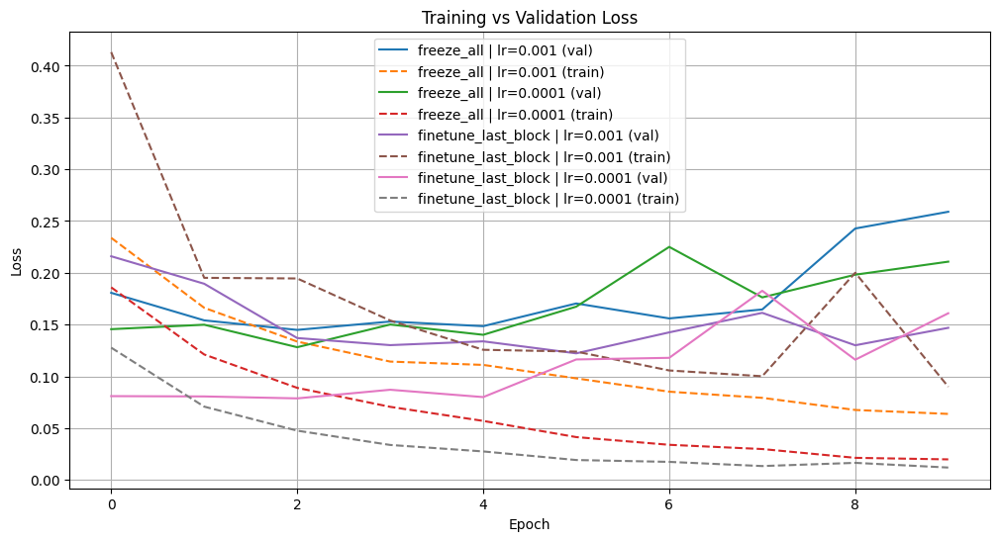
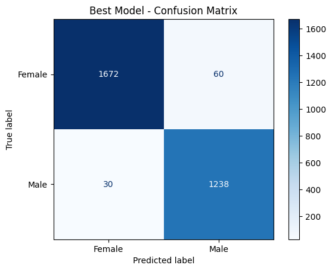

# Gender Classification on CelebA with VGG-16 Transfer Learning

[](https://colab.research.google.com/github/efe-akpinar/celeba-vgg16-transfer-learning/blob/main/celeba_vgg16_transfer_learning.ipynb)

A binary image classifier that predicts the `Male` attribute of [CelebA](https://mmlab.ie.cuhk.edu.hk/projects/CelebA.html) face images, built with PyTorch on top of an ImageNet-pretrained **VGG-16**. The project compares two transfer-learning strategies, a frozen backbone and fine-tuning the last convolutional block, across two learning rates.

**Best result: 97.0% test accuracy** (macro F1 0.97) on 3,000 held-out images.

## Approach

- **Data:** a 30,000-image subset of CelebA, split 80 / 10 / 10 (train / validation / test) with stratification on the label. The test set is used only for the final evaluation.
- **Model:** VGG-16 with ImageNet weights. Its last classifier layer is replaced by a single-logit output trained with `BCEWithLogitsLoss`.
- **Strategies:**
  - `freeze_all`: all convolutional layers frozen; only the classifier head is trained.
  - `finetune_last_block`: the last conv block (`conv5_1` to `conv5_3`) is unfrozen as well.
- **Training:** Adam, batch size 64, 10 epochs, 224×224 inputs, random horizontal flips.
- **Model selection:** the configuration with the lowest validation loss.

## Results

| Strategy | Learning rate | Best val loss | Test accuracy |
|---|---|---|---|
| `freeze_all` | 1e-3 | 0.1449 | 94.57% |
| `freeze_all` | 1e-4 | 0.1282 | 94.30% |
| `finetune_last_block` | 1e-3 | 0.1222 | 95.07% |
| **`finetune_last_block`** | **1e-4** | **0.0787** | **97.00%** |

<p align="center">
  
</p>
<p align="center">
  
</p>

**Takeaways**

- Fine-tuning the last conv block with a small learning rate clearly beats training only the head.
- `lr=1e-3` is unstable once pretrained conv weights are trainable.
- All runs overfit after about 3 to 6 epochs, so early stopping is the obvious next step.

## Running it

The notebook runs on Google Colab (a GPU runtime is recommended) or locally.

1. Get the data: a folder of CelebA images (`CelebA30k.zip`) and a CSV (`CelebA30k.csv`) with a `filename` column and CelebA's `Male` attribute (`-1` / `1`). Any subset of CelebA's `list_attr_celeba` annotations in this format works. The dataset is not included in this repo because of its size and the CelebA license (non-commercial research use only).
2. Put both files in:
   - **Colab:** `My Drive/celeba/` on Google Drive
   - **Locally:** `./data/`
3. Install the dependencies and open the notebook:

   ```bash
   pip install -r requirements.txt
   jupyter notebook celeba_vgg16_transfer_learning.ipynb
   ```

## Repository structure

```
├── celeba_vgg16_transfer_learning.ipynb   # full pipeline: data, model, training, evaluation
├── assets/                                # figures used in this README
└── requirements.txt
```
